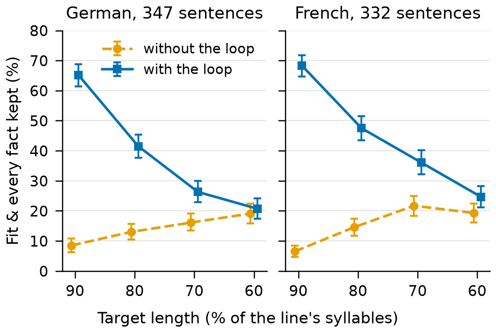
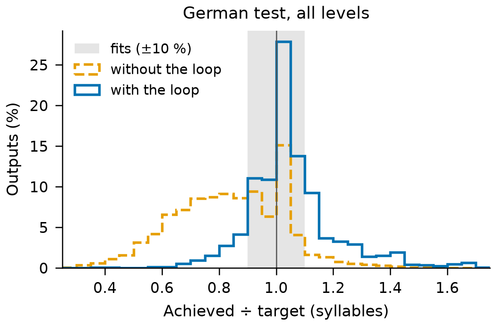
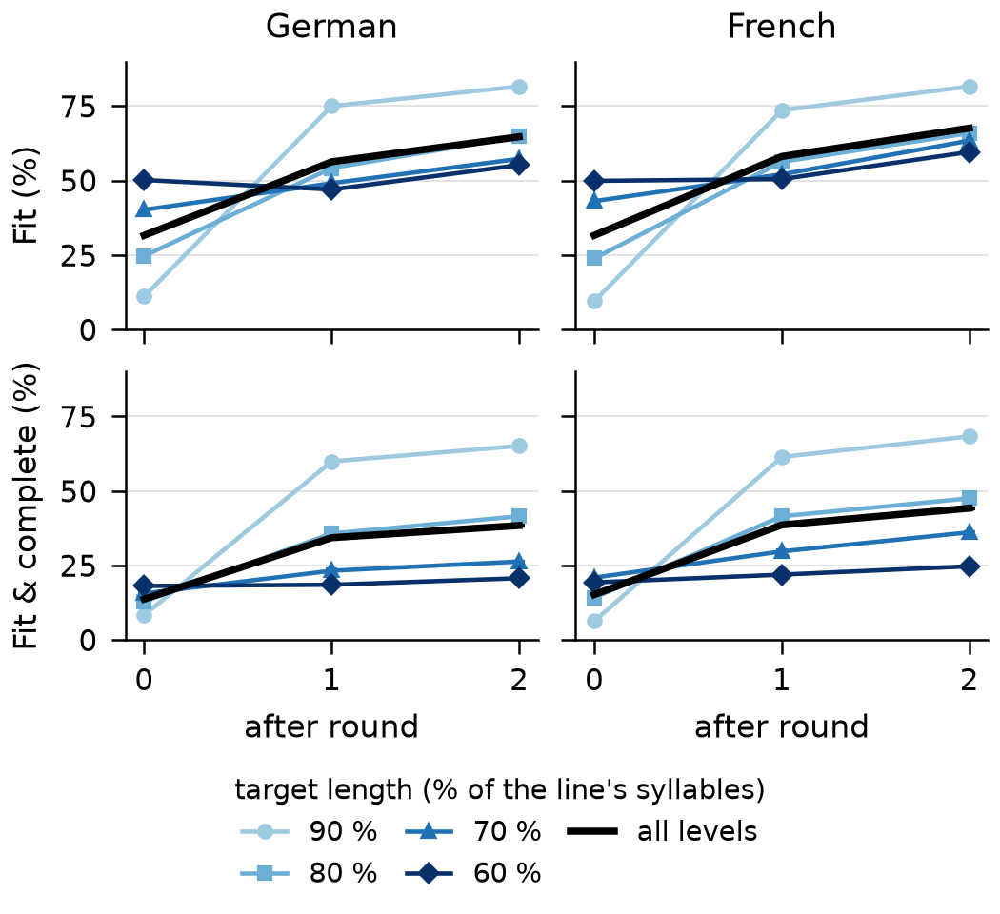
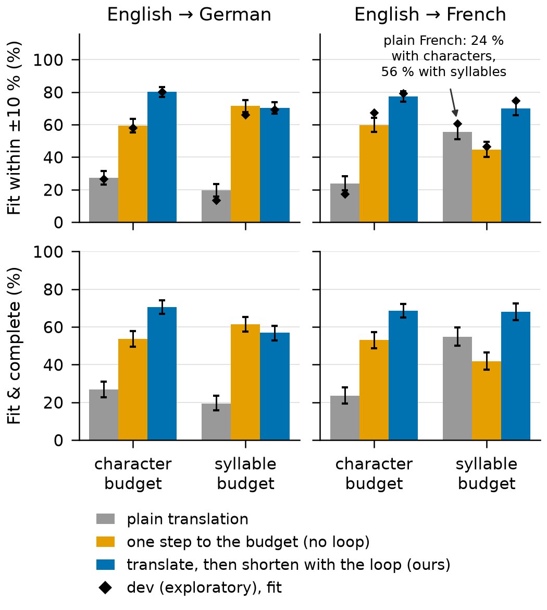

# Technical report — Isochron

Dubbing lines that fit their slot: Apertus 1.5 shortens a translated line to a syllable target without
dropping or adding meaning, guided by a repair loop.

- **Track:** Track 2B — Isochron
- **Event:** Online
- **Team:** **[PLACEHOLDER: team name]** — **[PLACEHOLDER: members]**
- **Demo:** **[PLACEHOLDER: link to the 2-minute demo video]**

Placeholders are marked **[PLACEHOLDER: …]**. Every number is labelled with its split, model,
quantisation and n. Dev numbers are exploratory; test numbers are final.

## 1. Summary

In dubbing, a translated line must fit the time the original actor speaks (isochrony), so translations
that run long are shortened by hand. We use Apertus 1.5 to shorten a line to a target length in
syllables, a proxy for spoken time, without dropping or adding information.

A single prompt failed our pre-registered go/no-go: it fit within ±10 % in only 40.7 % of outputs, where
60 % was required. Apertus over-shortens and mostly drops qualifiers. So we added a **repair loop**:
every candidate is checked for length, meaning and language, and Apertus revises with specific feedback,
at most twice.

Results on FLEURS test, with Apertus 1.5 8B in BF16 and a separate evaluation judge:
- Outputs that fit and keep every fact rose from 14.2 % to 38.4 % in German and from 15.5 % to 44.2 % in
  French. The paired gains are +24.3 and +28.6 points.
- The gain is largest for small cuts and shrinks as the cut deepens (Figure 2).
- When translating from English to a length budget (dev, exploratory), translating first and then
  shortening with the loop fits most often (Figure 5).

## 2. Architecture

The app (`isochron.app`, run by `make run`) reads lines and writes `output/results.jsonl` and
`output/summary.md`. It runs on the CPU in a Docker container and reaches Apertus only through
`LLM_NAME`, `LLM_BASE_URL` and `LLM_API_KEY`. Each candidate gets three checks:
- **Length:** syllables from eSpeak NG 1.52.0's phonemes.
- **Meaning:** the NLI model `mDeBERTa-v3-base-xnli-multilingual-nli-2mil7` must find entailment in both
  directions.
- **Language:** py3langid 0.4.0.

The evaluation judge (Qwen3-14B or Qwen3-8B) is not part of the method. It runs on its own server after
generation and never feeds it.

*Figure 1. The method inside the offline deployment (`make run-offline`). Apertus writes 4 candidates per
prompt. The app checks each one and, if the best fails a check, sends a revision prompt with feedback, at
most twice (blue: the loop). Neither container has a network interface; they share only 127.0.0.1.
Diagrams in `docs/architecture.md`.*

**Target architecture.**
- **b) Air-gapped:** `make run-offline`.
  - llama.cpp's server runs a local GGUF in a container with `network_mode: none`, and the app joins its
    namespace. The NLI model and the language identifier are inside the image.
  - Tested without Docker: from a fresh clone, under a macOS sandbox that allows only localhost
    connections, the 10 sample lines ran, external connections failed, and the outputs were identical to
    a networked run.
  - **[PLACEHOLDER: `make run-offline` in Docker; Docker was not installed on our development machine]**
- **a) On-premise:** the evaluation ran on HPI's H100 cluster. Apertus ran in the official vLLM container
  under Slurm, with the weights on the cluster's storage and Hugging Face offline.
- **Build time** needs the internet: Debian packages; the eSpeak NG source (SHA-256-pinned); the
  hash-checked packages of `uv.lock`, with torch as its CPU build; the NLI model at a pinned revision; and
  base images pinned by digest.
- **Run time:** `make run` needs only the LLM endpoint, and `make run-offline` needs nothing.

## 3. Use of Apertus

- **Model:** `swiss-ai/Apertus-v1.5-8B`, revision `a411d838`. The scripts for 70B are ready but have not
  been run.
- **Use:** inference only, as the system under test. Apertus writes and revises every candidate; no other
  model writes scored text.
- **Final numbers (HPC):** the official BF16 weights in the official container
  `swiss-ai/vllm_apertus_1.5_release` (vLLM 0.23.1rc1, fork `a601a9d`), on one H100. Settings: 60 % of
  GPU memory, `--max-model-len 8192`, and `--generation-config vllm`, so the model's own defaults never
  mix with ours.
- **Development, go/no-go and pilot (Mac):** llama.cpp b11429 on Metal, with a Q4_K_M GGUF of a text-only
  conversion of the official weights. llama.cpp cannot convert the multimodal checkpoint. The conversion
  copies the text backbone bit for bit, but its outputs were not compared with the official model's
  (`docs/local_llm.md`).
- **Prompts** (versioned in `src/isochron/prompts/`):
  - `shorten_syllables_v1` gives the line, the syllable target and its word equivalent, and asks for 4
    candidates as JSON.
  - `revise_v1` adds the current best candidate and the feedback.
- **Generation:** temperature 0.7, then top_p 0.95, with no top_k or min_p; at most 1,024 tokens;
  thinking off. Seeds 0, 1 and 2; round r of an item uses the seed + 1000 × r.

## 4. Data

- **FLEURS** (Conneau et al., 2022; CC BY 4.0), revision `70bb2e8`.
  - The English sentences and their German and French reference translations.
  - Dev: 147 German and 137 French. Test: 347 German and 332 French.
  - Its text comes from FLoRes-101 (CC BY-SA 4.0), so our data files are CC BY-SA 4.0. The sentences are
    from public Wikimedia articles and contain no personal data. No audio is stored or used.
- **Splits.** Prompts are tuned on dev only, outside the 50 go/no-go sentences. Test is used only for the
  final numbers.
- **Control pairs,** written by Claude (an AI assistant). No native speaker has reviewed them yet.
  - NLI suite: 200 German and French pairs (identity, paraphrase, deletion, insertion, negation).
  - Hard judge controls: 140 German pairs. 60 identity pairs, 20 same-meaning edits, 40 single changes
    of a modal, number or qualifier, and 20 inserted facts.
- **`data/sample_input.jsonl`:** 10 German dev sentences outside the go/no-go 50, the input of `make run`.

## 5. Evaluation

**Task (step 2).** Shorten a sentence in its own language to 90, 80, 70 or 60 % of its syllables, with
seeds 0, 1 and 2. It was pre-registered in `docs/eval_protocol.md`, which also logs every later change.

**Metrics.**
- **Fit:** within ±10 % of the syllable target.
- **Fact recall and added facts:** from the final judge, which lists the source's facts and marks each as
  kept, changed or dropped. The loop never sees it.
- **Fit & complete:** fits, keeps every fact and adds nothing.
- A missing output, or one in the wrong language, counts as a failure.
- **Intervals:** 95 % bootstrap over sentences (10,000 resamples). The loop's effect is a paired
  difference.

| Setup | Fit | Fit & complete |
|-------|-----|----------------|
| Baseline: go/no-go. Prompt v1, closest of 4, no loop; 8B Q4; 50 German dev sentences × 3 seeds; level 80 % | 40.7 % [31.3, 50.0]; **NO-GO**, 60 % needed | – (kept among fits, by the NLI: 62.3 %; 80 % needed) |
| Pilot without the loop (8B Q4; 30 German dev sentences; levels 90 and 80; seed 0) | 33.3 % [20.0, 46.7] | 18.3 % [8.3, 28.3] |
| **Ours** in the pilot | 73.3 % [61.7, 85.0] | 50.0 % [38.3, 61.7] |
| German test without the loop (8B BF16; 347 sentences × 4 levels × 3 seeds) | 34.9 % [32.5, 37.3] | 14.2 % [12.4, 16.1] |
| **Ours**, German test | 64.7 % [62.1, 67.2] | 38.4 % [35.7, 41.2] |
| French test without the loop (332 sentences) | 34.4 % [31.7, 37.0] | 15.5 % [13.5, 17.6] |
| **Ours**, French test | 67.6 % [65.0, 70.2] | 44.2 % [41.3, 47.0] |
| Paired gain on test, German / French (points) | +29.8 [27.2, 32.4] / +33.2 [30.6, 35.8] | +24.3 [22.2, 26.3] / +28.6 [26.4, 30.9] |

**The baseline** (go/no-go, `results/gonogo_step2_de.md`). The thresholds were fixed before any output,
and both failed. We report it as a null result.
- Asked for 80 % of the syllables, the chosen outputs averaged 67 %.
- In 30 cases where the NLI flagged a loss, three independent LLM annotators most often found a lost
  qualifier (80 %, by majority), then a lost clause (33 %); never a number.

**The pilot** (dev, `results/phase2_pilot.md`). Three prompt variants (facts first, word target, graded
targets) did not help on their own. With the loop, all four prompts were within noise, and a rule fixed
before the judge's output picked v1.

*Figure 2. Share of test outputs that fit and keep every fact, by target level, without (orange) and with
(blue) the repair loop. Apertus 1.5 8B BF16, 3 seeds; judge Qwen3-14B; bars: 95 % intervals over
sentences.*

**Test** (`results/step2_test.md`; final numbers).
- **Fit & complete gain by level (Figure 2):** in German, +56.7 points at 90 %, +28.5 at 80 %, +10.2 at
  70 %, and +1.6 [−0.6, +3.8] at 60 %. In French: +61.7, +32.9, +14.5 and +5.4 [3.2, 7.6].
- **At 60 %, fit barely moves:** −1.5 points in German and +4.5 in French. When nothing both fits and
  keeps the meaning, the loop keeps the meaning (NLI kept rises from 52 % to 96 % in German).
- **Without the loop, Apertus over-shortens** (achieved ÷ target 0.83). With the loop, misses run long
  (Figure 3).
- **Clean runs:** no output was in the wrong language, and none of the 16,296 judge verdicts was invalid.
- **Cost:** with 16 items in flight on one H100, about 10 s per output with the loop, against 0.7 s for one
  round.

*Figure 3. Achieved ÷ target syllables of every German test output, without the loop (4,136 with an
answer) and with it (4,164). Grey: the ±10 % band that fits.*

*Figure 4. Fit and fit & complete after each round of the loop, by target level, computed from the logged
test runs (`results/step2_test_rounds.md`). Round 0 is the loop's own pick before any revision, which
prefers meaning over length. A round's best candidate that the judge never scored counts as incomplete;
counting it as complete adds at most 0.7 points.*

A third round would likely help little: round 2 added only about 4 points of fit & complete in German and
5 in French, after about 21 and 24 in round 1, and accepted 20–23 % of the items still open against 39–42 %
in round 1, so even at round 2's rate a third round would add about 3 and 4 points (an estimate; Figure 4).

**Checking the measures.**
- **Syllables.** eSpeak NG matched hand counts on 46 of 50 items. The cluster's build counts all 963 German
  and French references exactly as the Mac does.
- **Language check.** It flags none of 1,956 German FLEURS sentences, and all 3 English pilot outputs.
- **NLI.** It passes its suite (82–100 % per type) but catches only 3 of 14 qualifier changes.
- **Final judge.** Validated on both suites before use. On the hard controls:
  - Qwen3-14B BF16: 84 % mean. It catches 7 of 14 qualifier and 10 of 13 modal changes.
  - Qwen3-8B Q4: 78 % mean (5 of 14 and 8 of 13).
  - A rule fixed before the result made Qwen3-14B the main judge. The difference is within noise (paired
    McNemar, p = 0.34).
  - Per control type: `docs/figures/fig6_judges.png`.
- **HPC smoke test** (10 dev items): fit with the loop was 7 of 10, against 6 of 10 on Q4.

*Figure 5. Step 4 on dev (exploratory): fit within ±10 % of a character or syllable budget. The three
systems are plain translation, one step to the budget (no loop), and translation shortened with our
loop. 97 German and 90 French sentences × 3 seeds; 95 % intervals. The French syllable budget is
1.16 × the English syllables, so plain French translation often meets it already.*

**Step 4: translate to a length budget** (`results/hpc_8b_step4_dev.md`).
- Translating first and then shortening with the loop fits most often in all four settings: 69–80 %
  (Figure 5).
- Its meaning, checked by the NLI against the human reference, is about level with plain translation:
  79–82 % against 79 % in German, and 75–79 % against 73 % in French.
- In German with the syllable budget, one step and ours are within noise.

## 6. Limitations

- **Syllables are a proxy for time.** No speech was synthesised or timed.
- **Weak on small losses.** The NLI misses most dropped qualifiers, and the judge misses half. So fact
  recall and fit & complete are upper bounds, and added facts are likely undercounted.
- **Unreviewed controls.** No native speaker has reviewed the control pairs or the outputs.
- **Tight targets give long lines.** The loop prefers meaning over length. Misses therefore run long
  (German, 60 %: 321 too long against 145 too short, of 1,041), and 2–9 % of German outputs per level are
  the input unchanged.
- **French JSON.** Apertus often escapes French apostrophes as `\'`, which strict JSON rejects: 2.9 % of
  French rounds against 0.5 % of German ones. 11 French test items ended without an answer, counted as
  failures. A lenient parser must first be tuned on dev.
- **No grammar check.** Some outputs are ungrammatical (*"den 18. Jahrhundert Markt"*).
- **Development model.** Development used a derived 4-bit model; only the final runs used official BF16.
- **Not tested:** Italian, the 70B model, and the Docker images, which have not been built yet.
- **Batching.** Processing 16 items at once on the HPC changes outputs slightly against a sequential run.

## 7. Reproducibility

- **Commits:** the test runs used `68492f2`. **[PLACEHOLDER: the commit of the final reports]**
- **Hardware:** an Apple M3 with 16 GB, and one NVIDIA H100 80 GB per HPC job. All jobs together used 4.46
  H100-hours (sacct), of a budget of 12.
- **Seeds:** generation 0, 1 and 2, plus 1000 × the round. Judge: temperature 0, seed 0. Bootstrap:
  seed 0.
- **Records:** every results file records its date, commit, model and quantisation, endpoint, TTS
  (none), seeds and n. Raw runs keep every prompt and answer.
- **Rebuild:**
  - `docs/local_llm.md` (Mac) and `docs/hpc.md` (exact `sbatch` lines).
  - `make figures` redraws every figure from committed results only.
  - `uv run scripts/report_pdf.py` renders this report (A4, two columns).
  - `make run` runs the demo.

## 8. Next steps

- Seconds instead of syllables: synthesise each output and fit it to the source's trimmed slot.
- A native-speaker review, and a meaning check aimed at qualifiers.
- Apertus 1.5 70B, Italian, and step 3 (exact targets).
- Subtitle formats (SRT, TTML), and a "cannot fit without losing meaning" flag instead of a long line.

## License

CC BY 4.0 (CC-BY-4.0); all HackApertus projects are open source. The code is Apache-2.0 and the data
files are CC BY-SA 4.0 (`docs/licences.md`).

## References

- Anastasopoulos, A. et al. (2022). Findings of the IWSLT 2022 Evaluation Campaign. *Proc. IWSLT 2022.*
- Conneau, A. et al. (2022). FLEURS: Few-shot Learning Evaluation of Universal Representations of Speech.
  arXiv:2205.12446.
- Goyal, N. et al. (2022). The Flores-101 Evaluation Benchmark. *TACL* 10. arXiv:2106.03193.
- He, P., Gao, J. and Chen, W. (2021). DeBERTaV3. arXiv:2111.09543.
- Kwon, W. et al. (2023). Efficient Memory Management for LLM Serving with PagedAttention (vLLM).
  *SOSP 2023.*
- Lakew, S. M. et al. (2022). Isometric MT: Neural Machine Translation for Automatic Dubbing.
  *ICASSP 2022.*
- Laurer, M. et al. (2024). Less Annotating, More Classifying. *Political Analysis* 32(1).
- Lui, M. and Baldwin, T. (2012). langid.py: An Off-the-shelf Language Identification Tool. *ACL 2012
  Demos.*
- Okabe, M. and Ito, K. (2008). Color Universal Design: how to make figures for colorblind people.
- Pellegrino, F., Coupé, C. and Marsico, E. (2011). A cross-language perspective on speech information
  rate. *Language* 87(3).
- Qwen Team (2025). Qwen3 Technical Report. arXiv:2505.09388.
- Swiss AI Initiative (2025). Apertus 1.5 model cards: huggingface.co/swiss-ai/Apertus-v1.5-8B.
- eSpeak NG; llama.cpp; py3langid; matplotlib (github.com/espeak-ng, ggml-org/llama.cpp, adbar/py3langid,
  matplotlib/matplotlib).
