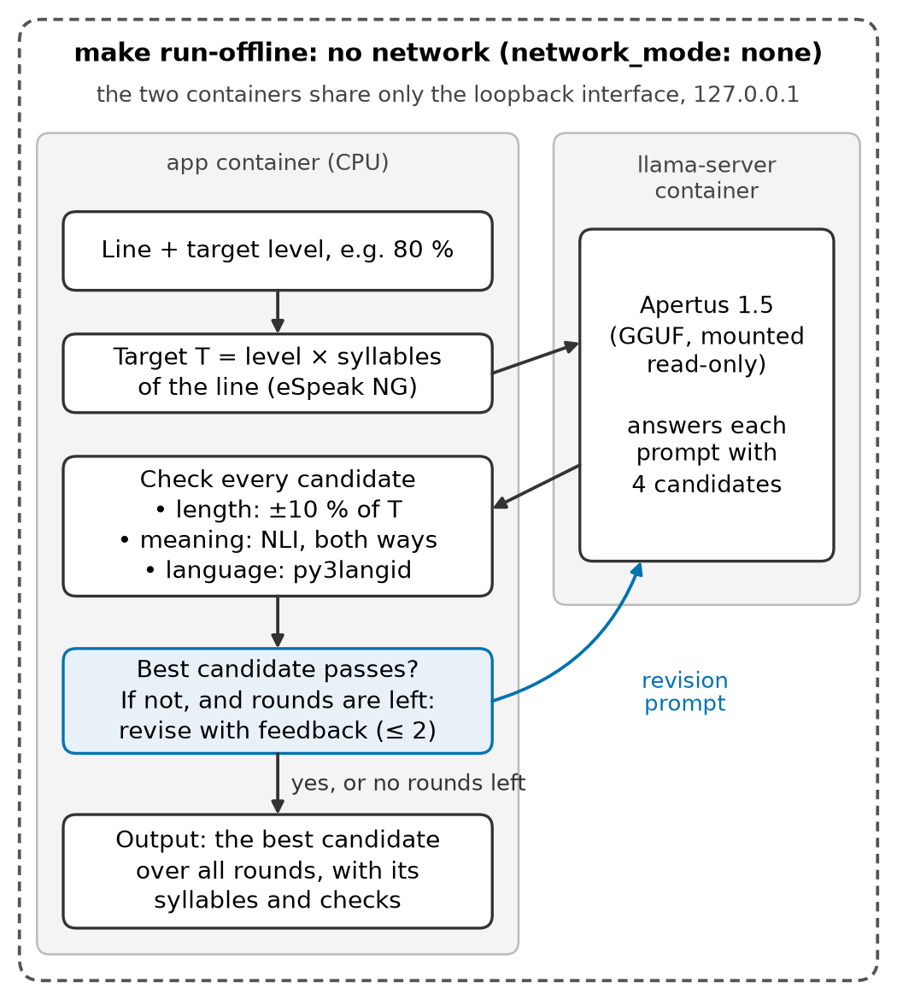

# Technical report — Isochron

Dubbing lines that fit their slot: Apertus 1.5 translates a line from English and shortens it to a length
budget, aiming to keep its meaning, guided by a repair loop.

- **Track:** Track 2B — Isochron · **Event:** Online · **Team:** SONALAB — Kaushik Mukherjee, Sören
  Hübner · **Demo:** **[PLACEHOLDER: link to the 2-minute demo video]**

Every number is labelled with its split, model, quantisation and n. Dev numbers are exploratory; test
numbers are final. Analyses added after the test outputs existed are marked "post-hoc, added after test
outputs existed" (here, for short, "post-hoc").

**Why.** Translations run long. On FLEURS test, the human German and French references have a median
1.18 × the English characters (without spaces), and 75 % are more than 10 % longer (post-hoc;
`results/expansion_en_de_fr.md`): the same direction as IBM's guidance, cited by the W3C, that European
translations of English run to about 130 %, though smaller. Apertus's plain translations behave the same
(1.16 and 1.19). In dubbing, a line must fit the time the original actor speaks (isochrony), and running
long is the costly error, as it overlaps the next line.

**What we did.** Apertus 1.5 translates an English line into German or French within a length budget,
in characters or in syllables, aiming to drop or add no information. Ours translates first, then
shortens with a **repair loop**: every candidate is checked for length, meaning and language, and Apertus
revises with specific feedback, at most twice. Baselines: (a) plain translation; (b) one step to the
budget (isometric prompting, with characters).

**Key results** (FLEURS test; Apertus 1.5 8B, BF16; step 4: 347 German and 332 French sentences × 3
seeds, 4 settings = 2 languages × 2 budgets; ranges over the settings):

| Result | (a) plain | (b) one step | (c) ours |
|---|---|---|---|
| Step 4: fit within ±10 % of the budget (%, pre-registered) | 19.6–55.6 | 44.7–71.6 | **69.9–80.2** |
| Step 4: too long, over +10 % (%, post-hoc) | 20.5–79.1 | **1.4–14.8** | 4.1–20.4 |
| Step 4: meaning kept vs reference, main NLI (%, pre-registered) | 79.5–79.7 | 69.7–76.8 | **80.6–81.6** |
| Step 4: meaning kept vs reference, second NLI (%, post-hoc) | **88.2** | 75.4–81.6 | 82.9–87.7 |
| Timing, budget calibrated to one TTS voice: fits the English slot ±10 % (of 99; exploratory) | 25 | – | **47** |
| Timing, same run: too long (of 99) | 51 | – | **24** |
| Native speaker: meaning kept (descriptive; different sentences per system) | 12 of 14 | – | 12 of 16 |

- **Fit:** ours fits most often in three of the four settings; with a German syllable budget, one step
  ties. One step overruns least because it over-shortens, but it keeps meaning less often than ours (all
  four settings, both NLIs) and fits less often (apart from that tie).
- **Meaning:** by the pre-registered NLI, ours keeps meaning as often as plain translation; a second NLI
  that the loop never sees finds ours 0.5–5.3 points below plain translation (post-hoc).
- **Timing:** syllables predict seconds for one voice (r = 0.98), not across human readers (κ ≈ 0): the
  budget must be calibrated to the target voice. Calibrated, ours fits 47 of 99 lines, plain 25.
- **Caveats:** every meaning check misses at least half of the planted qualifier changes (Appendix); the
  main NLI is the loop's own model; the native-speaker check is one rater on 30 lines.

## 1. Method

The app (`isochron.app`; `make run`, or `make run-offline` with a local model) runs the engine, the repair
loop (Figure 1); step 4 runs it on Apertus's plain translation (`isochron.step4`). It reaches Apertus only
through `LLM_NAME`, `LLM_BASE_URL` and `LLM_API_KEY`. Each candidate gets three checks: **length**
(syllables from eSpeak NG 1.52.0's phonemes, or characters without spaces), **meaning** (the NLI model
`mDeBERTa-v3-base-xnli-multilingual-nli-2mil7` must find entailment both ways) and **language**
(py3langid 0.4.0). The evaluation judge (Qwen3-14B) is not part of the method and never feeds it.

*Figure 1. The engine in the offline deployment (`make run-offline`). Apertus is asked for 4 candidates
per prompt; the app checks each and, if the best fails, sends a revision prompt with feedback, at most
twice (blue; not drawn: while no candidate exists, the first prompt again). The two containers share only
the loopback. In step 4, ours runs this loop on the plain translation when it is over 1.10 × the budget,
with T = the budget and the NLI against that translation. Diagrams: `docs/architecture.md`.*

**Step 4 systems and budgets.** (a) plain translation; (b) one step: 4 candidates, the closest to the
budget chosen; (c) ours: (a), kept if at most 1.10 × the budget (also when shorter than the band),
otherwise shortened with the loop. Budgets, ±10 %: the English characters without spaces (isometric;
Anastasopoulos et al., 2022), or the English syllables × the target's speech rate ÷ English's (Pellegrino
et al., 2011: German 0.964, French 1.160). Frozen before any test output (protocol v2.17): prompts by
hash, selection, loop, keep rule and metrics: fit; kept vs reference (main) and vs source (NLI both
ways); fit & complete (fits, and Qwen3-14B finds every source fact kept and nothing added). A missing or
wrong-language output fails every metric; 95 % bootstrap intervals over sentences (10,000, seed 0).

**Use of Apertus.** `swiss-ai/Apertus-v1.5-8B` (revision `a411d838`), inference only, as the system under
test: it writes and revises every candidate. Final numbers: the official BF16 weights in the official
container `swiss-ai/vllm_apertus_1.5_release` (vLLM 0.23.1rc1, fork `a601a9d`) on one H100, 60 % of GPU
memory, `--max-model-len 8192`, `--generation-config vllm`. Go/no-go, pilot and prompt development:
llama.cpp b11429 on a Mac with a Q4_K_M GGUF of a text-only conversion (`docs/local_llm.md`; its outputs
were not compared with the official model's). Prompts
(`src/isochron/prompts/`): `translate_plain_v1`, `translate_budget_*_v1`, `shorten_*_v1` (4 candidates
as JSON), `revise_v1`, `revise_chars_v1`. Temperature 0.7, top_p 0.95, at most 1,024 tokens, thinking off;
seeds 0, 1, 2, round r at seed + 1000 × r. 70B: scripts ready, not run.

**Target architecture (mandatory).** **b) Air-gapped:** `make run-offline` runs llama.cpp's server on a
local GGUF in a container with `network_mode: none`; the app joins its namespace, with the NLI model and
the language identifier inside the image. Tested from a fresh clone (Colima, Apple M3, arm64): the 10
sample lines on the CPU, exit 0; outbound requests fail. Also tested under a macOS sandbox allowing only
localhost: identical outputs. **a) On-premise:** the evaluation ran on HPI's H100 cluster (vLLM container
under Slurm, weights on the cluster, Hugging Face offline). Build time needs the internet (pinned
packages, eSpeak NG source, NLI model, base images by digest); `make run` needs only the LLM endpoint,
`make run-offline` nothing.

## 2. Results

**Step 4 on test** (`results/step4_test.md`; final; % with 95 % intervals; 1,041 German and 996 French
outputs per row). Too long and the second NLI are post-hoc (`results/step4_too_long.md`,
`results/step4_test_nli2.md`).

| EN →, budget | System | Fit ±10 % | Too long | Kept vs reference (main NLI) | Kept vs source (NLI) | Fit & complete (judge) | Kept vs ref. (2nd NLI) |
|---|---|---|---|---|---|---|---|
| DE, characters | (a) plain | 27.2 [23.0, 31.4] | 71.4 | 79.5 [75.7, 83.3] | 78.2 [74.2, 82.1] | 26.8 [22.7, 31.0] | 88.2 |
| DE, characters | (b) one step | 59.4 [55.1, 63.5] | 1.9 | 74.1 [70.3, 77.8] | 69.5 [65.7, 73.4] | 53.7 [49.6, 57.8] | 78.2 |
| DE, characters | **(c) ours** | **80.2 [77.1, 83.2]** | 13.8 | 80.6 [77.0, 84.1] | 79.2 [75.6, 82.5] | **70.5 [66.8, 74.2]** | 84.6 |
| DE, syllables | (a) plain | 19.6 [15.8, 23.6] | 79.1 | 79.5 [75.7, 83.3] | 78.2 [74.2, 82.1] | 19.5 [15.8, 23.4] | 88.2 |
| DE, syllables | (b) one step | **71.6 [67.7, 75.2]** | 14.8 | 76.8 [73.2, 80.2] | 72.5 [68.9, 76.1] | **61.5 [57.4, 65.4]** | 80.3 |
| DE, syllables | **(c) ours** | **70.3 [66.9, 73.8]** | 20.4 | 81.6 [78.2, 84.6] | 77.7 [74.2, 81.1] | **56.9 [52.9, 60.7]** | 82.9 |
| FR, characters | (a) plain | 23.9 [19.7, 28.3] | 74.2 | 79.7 [75.7, 83.6] | 73.5 [69.0, 77.8] | 23.5 [19.4, 27.9] | 88.2 |
| FR, characters | (b) one step | 59.8 [55.5, 64.1] | 5.1 | 69.7 [65.8, 73.5] | 64.7 [60.7, 68.6] | 53.0 [48.7, 57.3] | 75.4 |
| FR, characters | **(c) ours** | **77.3 [74.0, 80.6]** | 12.2 | 80.7 [77.1, 84.1] | 76.9 [73.1, 80.5] | **68.6 [64.9, 72.2]** | 85.3 |
| FR, syllables | (a) plain | 55.6 [50.9, 60.3] | 20.5 | 79.7 [75.7, 83.6] | 73.5 [69.0, 77.8] | 54.9 [50.2, 59.7] | 88.2 |
| FR, syllables | (b) one step | 44.7 [40.1, 49.3] | 1.4 | 74.9 [71.2, 78.5] | 72.4 [68.6, 76.0] | 41.9 [37.4, 46.4] | 81.6 |
| FR, syllables | **(c) ours** | **69.9 [65.7, 74.1]** | 4.1 | 81.5 [77.8, 85.1] | 74.4 [70.2, 78.5] | **68.1 [63.7, 72.4]** | 87.7 |

Bold: the highest fit or fit & complete in its setting, and any system whose paired interval with it
includes 0. Fit & complete is an upper bound (Appendix). Paired differences, all post-hoc:
- **Fit:** ours − one step +17.5 to +25.2 points in three settings; German syllables a tie (−1.2 [−6.0,
  +3.6]). Ours − plain +14.3 to +53.4, every interval above 0. Dev agreed for (c) within 5 points.
- **Too long:** ours − plain −16.4 to −61.9 points; ours − one step +2.7 to +11.9: one step undershoots.
- **Meaning, main NLI:** ours − plain +1.0 to +2.0 (only French syllables excludes 0); ours − one step
  +4.8 to +11.0. **Second NLI:** ours − plain −0.5 to −5.3; one step shows a similar gap, but on lines the
  loop shortened ours gains more from the main NLI than one step (German syllables +6.0 [+1.3, +10.7]):
  there the loop's own NLI probably inflates ours.
- **French, characters vs syllables (text only):** the French syllable budget is 1.16 × the English
  syllables, so plain French meets it in 55.6 % of lines, the character budget in 23.9 %; in one step to
  the syllable budget Apertus over-shortens. This is about text length; real speech does not confirm
  syllables over characters (Timing).
- **Parse failures** (as frozen, a miss): one step lost 114 of 4,074 answers, mostly French; ours ended
  without an output on 10 lines. Read again with `\'` as `'` (post-hoc), 70 come back, and ours still
  leads French characters by 14.2 [9.0, 19.5] points of fit.

**Timing in seconds** (exploratory, post-hoc; `results/human_speech.md`, `results/time_check_qwen.md`,
`results/time_check_calibrated.md`). Human readings: FLEURS test, recordings not flagged noisy, trimmed
alike. TTS: Qwen3-TTS, preset voice Aiden (Apache-2.0), 3 clean takes per line (Whisper check), median.

| Test | n | Fits ±10 %: (a) / (c) | Too long: (a) / (c) | Paired |
|---|---:|---|---|---|
| Human readings: does a ruler predict a ±10 % fit to the English? | 209 DE, 221 FR | κ −0.16 to +0.02 (syllables and characters) | – | – |
| TTS, step 4's syllable budget (sheet sources) | 21 | 8 / 6 | 7 / 4 | McNemar p = 0.73 |
| TTS, budget = English seconds ÷ the voice's 0.231 s per syllable (dev) | 99 | 25 / **47** | 51 / **24** | 22 to 0, p = 4.8e-07 |

For one voice, syllables predict seconds (r = 0.98); across human readers, speed dominates (r = 0.77–0.93
within a language, yet κ ≈ 0), and these readers speak 1.13 (DE) and 1.35 (FR) times as many syllables
per second as the English ones, not the 0.964 and 1.160 our budget assumes. With the uncalibrated budget,
ours ran short for this voice (11 of 15 misses). An earlier Chatterbox run failed its own checks
(`results/time_check.md`).

**Native speaker** (`results/human_check.md`; descriptive). One German native speaker rated, without system
labels, one line per English source (25 of the 50 sheet lines, step 4 test, German, syllable budget,
seed 0); in the 5 identical pairs the rating counts for both, so n differs per system and the rates come
from different sentences (no test). The rater found, in ours: an inch symbol replacing "Zoll" (eSpeak
counts it as 0 syllables: a way to game the count), a one-word fragment, broken grammar, a dropped "some";
in both: "sharpener" as "Spitze", "spotted deer" as "Hirschziegen".

| System | n | Meaning kept | Minor loss | Wrong | Adds information | Natural German |
|---|---:|---|---|---|---|---|
| (a) plain | 14 | 86 % [60, 96] | 1 | 1 | 0 | 71 % [45, 88] |
| (c) ours | 16 | 75 % [51, 90] | 3 | 1 | 0 | 69 % [44, 86] |

**Step 2, the engine** (`results/step2_test.md`; test, final): shorten a sentence in its own language to
90–60 % of its syllables (347 German and 332 French × 4 levels × 3 seeds), without the loop (closest of
4 candidates) and with it; the loop's effect is a paired difference, pre-registered (v2.12).

| Setup | Fit | Fit & complete |
|---|---|---|
| Go/no-go (dev; 8B Q4; 50 German × 3; level 80 %) | 40.7 % [31.3, 50.0]: **NO-GO** (60 % needed) | NLI kept among fits 62.3 % (80 % needed) |
| German / French: without → with the loop | 34.9 → 64.7 % / 34.4 → 67.6 % | 14.2 → 38.4 % / 15.5 → 44.2 % |
| Paired gain (points) | +29.8 [27.2, 32.4] / +33.2 [30.6, 35.8] | +24.3 [22.2, 26.3] / +28.6 [26.4, 30.9] |

The go/no-go failed both pre-registered thresholds, a null result (`results/gonogo_step2_de.md`); a
qualifier was lost in 24 of the 30 cases the NLI flagged. Pilot (dev): three prompt variants did not help
alone, and with the loop all four were within noise; a rule fixed in advance picked v1. By level, fit &
complete gains +56.7 points at 90 % and +1.6 [−0.6, +3.8] at 60 % in German (French +61.7 and +5.4
[+3.2, +7.6]); at 60 % the loop prefers what its NLI accepts and, with the loop, misses run long.

**Cost per line** (post-hoc; `results/step4_test_cost.md`; calls, seconds and tokens measured; H100-s an
estimate from the measured generation time):

| System | LLM calls | LLM s | Loop checks, s | Completion tokens | H100-s (estimate) |
|---|--:|--:|--:|--:|--:|
| (a) plain | 1.01 | 0.41 | – | 42 | 0.04–0.10 |
| (b) one step | 1.00 | 0.93 | – | 124 | 0.08–0.29 |
| (c) ours, (a) included | 2.40 | 1.57 | 5.77 | 197 | 0.47–0.65 |

**More, one line each** (all post-hoc unless marked): fit by setting with dev (`docs/figures/fig2_step4.png`);
where lengths fall (`docs/figures/fig3_step4_lengths.png`); fit gained vs meaning lost
(`docs/figures/fig4_tradeoff.png`); second NLI in full (`results/step4_test_nli2.md`); JSON sensitivity
(`results/step4_test.md`); step 2 by level, pre-registered (`docs/figures/fig5_compression.png`); rounds
of the loop (`results/step2_test_rounds.md`, `docs/figures/fig6_rounds.png`); step 2 lengths
(`docs/figures/extra_step2_lengths.png`); judges on the controls (`docs/figures/extra_judges.png`);
demo lines (`docs/demo_video.md`).

## 3. What we learned about Apertus

Measured, in the test runs: it **follows a length target loosely and over-shortens** (asked for 80 % of
the syllables, its closest candidate gave 0.79 × the target in German, 0.78 × in French; one step to the
French syllable budget gave 0.88 × and fit 44.7 %, below plain's 55.6 %). It **revises well with specific
feedback**: the loop accepted 39–42 % of open lines after the first revision, 20–23 % after the second
(post-hoc). It **stays in the target language** (2 of 10,185 step 4 outputs, none of 16,296 step 2
outputs, in another language). Its **JSON breaks in French** (`\'` in 3.5 % of French one-step answers,
German 1 of 2,082). It **often returns fewer candidates than asked** (686 of 5,655 loop rounds not 4).
It **mistranslates rare words** in both systems (native speaker: "Spitze", "Hirschziegen").

## 4. Limitations

- **Meaning checks miss small changes** (Appendix): the judge's fit & complete is an upper bound, looser
  from English (step 4), where its near-zero added facts (0.0–0.1 %) mean little. **The main NLI is the
  loop's own model**; the second NLI rates ours 2.8–5.3 points below plain in three settings.
- **Timing uses one TTS voice**, not dubbing actors; the budget must be calibrated to the voice.
- **Native check:** one rater, 30 rated lines, rates from different sentences; blinding was partial
  (both lines of a source were on the sheet, the shorter visible; the rater noted "looks longer").
  The control pairs, written by Claude, are not reviewed by a native speaker.
- **The loop can game the length count** with symbols eSpeak does not count (`"` for "Zoll").
- **Tight targets give long lines** (step 2, with the loop). **Strict JSON** counts as a failure, as
  frozen: in step 4, (b) lost 114 of 4,074 answers, (a) 9 of 2,037, (c) 28 of 4,074 lines.
  **No grammar check** (*"den 18. Jahrhundert Markt"*).
- **Development model:** go/no-go, pilot and prompts used a 4-bit derivative; step 4 dev and all test runs
  used the official BF16 weights. **Not tested:** Italian, 70B, Docker on an amd64 host (only under
  emulation; `results/docker_check.md`). **Batching** 16 items on the HPC may change outputs slightly.

## 5. Data and reproducibility

- **Data:** FLEURS (Conneau et al., 2022; CC BY 4.0) at `70bb2e8`: dev 147 German and 137 French, test
  347 and 332; text from FLoRes-101 (CC BY-SA 4.0), so our data files are CC BY-SA 4.0; public Wikimedia
  articles, no personal data. Prompts tuned on dev only, outside the 50 go/no-go sentences. Control pairs:
  200 NLI pairs and 140 hard German judge controls. No audio is stored in the repo; the FLEURS recordings
  (CC BY 4.0) and synthetic speech (Qwen3-TTS; a failed Chatterbox run, MIT) were used only for the timing
  check and the demo (post-hoc). Measures checked: eSpeak matched hand counts on 46 of 50 items and counts
  all 963 references alike on Mac and cluster; the language check flags none of 1,956 German sentences.
- **Commits:** step 2 test runs `68492f2`, step 4 test runs `7b22d93`. **[PLACEHOLDER: the commit of the
  final reports]**
- **Hardware:** Apple M3 (16 GB); one H100 80 GB per HPC job; 6.48 H100-hours of a budget of 12 (sacct,
  2026-10-13): 6.03 setup and experiments, 0.46 text-to-speech (rounded).
- **Records:** every results file gives date, commit, model and quantisation, endpoint, TTS (only the
  timing files: `time_check.md` Chatterbox; `time_check_qwen.md`, `time_check_calibrated.md` Qwen3-TTS),
  seeds and n. Judge: temperature 0, seed 0. Rebuild: `docs/hpc.md`, `docs/local_llm.md`, `make figures`,
  `uv run scripts/report_pdf.py`, `make run`.
- **Next steps:** calibrate the syllable budget to the target voice and check the fit with that voice (done
  for one TTS); an asymmetric target that aims slightly short; a "cannot fit" flag for human review; a meaning
  check aimed at qualifiers; 70B, Italian, step 3; subtitle formats.

**License:** CC BY 4.0 (CC-BY-4.0); all HackApertus projects are open source. Code Apache-2.0, data files
CC BY-SA 4.0 (`docs/licences.md`).

## References

Anastasopoulos et al. (2022), Findings of the IWSLT 2022 Evaluation Campaign, *Proc. IWSLT*. · Conneau et
al. (2022), FLEURS, arXiv:2205.12446. · Goyal et al. (2022), The Flores-101 Evaluation Benchmark, *TACL*
10. · He, Gao and Chen (2021), DeBERTaV3, arXiv:2111.09543. · Kwon et al. (2023), PagedAttention (vLLM),
*SOSP*. · Lakew et al. (2022), Isometric MT, *ICASSP*. · Laurer et al. (2024), Less Annotating, More
Classifying, *Political Analysis* 32(1). · Lui and Baldwin (2012), langid.py, *ACL Demos*. · Pellegrino,
Coupé and Marsico (2011), A cross-language perspective on speech information rate, *Language* 87(3). ·
Qwen Team (2025), Qwen3 Technical Report, arXiv:2505.09388. · Qwen Team, Qwen3-TTS, model card
Qwen/Qwen3-TTS-12Hz-1.7B-CustomVoice. · Radford et al. (2023), Whisper, *ICML*. · Swiss AI Initiative
(2025), Apertus 1.5, huggingface.co/swiss-ai/Apertus-v1.5-8B. · W3C Internationalization, Text size in translation,
w3.org/International/articles/article-text-size. · eSpeak NG, llama.cpp, py3langid, matplotlib (GitHub).

## Appendix: planted-control catch rates

Caught, of the planted German changes, with the source in German or in English as for step 4
(`results/judge_validation_*`, `results/step4_test_nli2.md`; the second NLI's columns are post-hoc). The
NLI and the judge were validated before use; a rule fixed before the result made Qwen3-14B the main judge
(identity pairs 100 % complete; 90 % needed).

| Planted change | NLI | NLI, from English | Second NLI | Second NLI, from English | Judge | Judge, from English |
|---|---:|---:|---:|---:|---:|---:|
| Qualifier (14) | 3 | 6 | 1 | 1 | 7 | 0 |
| Modal (13) | 10 | 7 | 1 | 0 | 10 | 4 |
| Number (13) | 12 | 12 | 9 | 5 | 13 | 12 |
| Inserted fact (20) | 20 | 20 | 20 | 14 | 16 | 5 |
