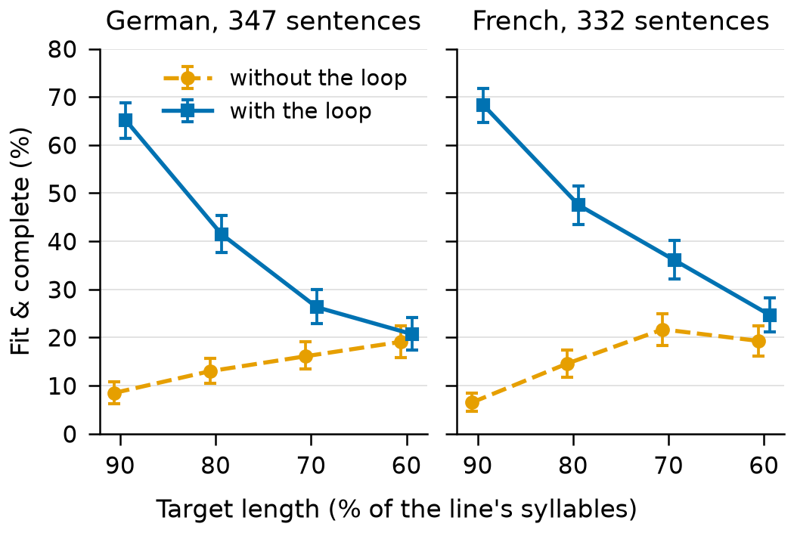

# Technical report — Isochron

Dubbing lines that fit their slot: Apertus 1.5 translates a line from English and shortens it to a length
budget, aiming to keep its meaning, guided by a repair loop.

- **Track:** Track 2B — Isochron
- **Event:** Online
- **Team:** **[PLACEHOLDER: team name]** — **[PLACEHOLDER: members]**
- **Demo:** **[PLACEHOLDER: link to the 2-minute demo video]**

Placeholders are marked **[PLACEHOLDER: …]**. Every number is labelled with its split, model,
quantisation and n. Dev numbers are exploratory; test numbers are final. Analyses added after the test
outputs existed are marked "post-hoc, added after test outputs existed".

## 1. Summary

In dubbing, a translated line must fit the time the original actor speaks (isochrony), so translations
that run long are shortened by hand. We use Apertus 1.5 to translate an English line into German or
French within a length budget, in characters or in syllables (a proxy for spoken time), aiming to drop
or add no information. Our method translates first and then shortens with a **repair loop**: every
candidate is checked for length, meaning and language, and Apertus revises with specific feedback, at
most twice.

Step 4, translating English to a length budget, on FLEURS test (Apertus 1.5 8B BF16; 347 German and 332
French sentences × 3 seeds), with the metrics frozen before any test output (post-hoc analyses marked):
- **Fit within ±10 %:** with a character budget, ours fits 80.2 % (German) and 77.3 % (French) of lines,
  against 59.4 and 59.8 % for asking Apertus for the budget in one step, and 27.2 and 23.9 % for plain
  translation. With a syllable budget, ours fits 70.3 and 69.9 %.
- **Meaning:** by the pre-registered NLI (natural-language inference) against the human reference, ours
  keeps it as often as plain translation (80.6–81.6 % against 79.5–79.7 %), and one step to the budget
  less often (69.7–76.8 %). A second NLI that the loop never sees (post-hoc, added after test outputs
  existed) finds ours 2.8–5.3 points below plain translation in three settings.
- **Where ours does not win:** with a German syllable budget, one step fits as often (71.6 %).
- **The engine (step 2):** shortening in the same language, the loop raised the outputs that fit and, by
  the judge, keep every fact and add nothing (an upper bound) from 14.2 to 38.4 % in German and from 15.5
  to 44.2 % in French.
- **Caveats:** all three meaning checks miss most qualifier changes, and the second NLI and the judge
  working from English, as in step 4, also miss most modal changes (Section 6). A blind sheet of 50 German
  lines for a native speaker, plain translation against ours, is ready but not yet rated.

## 2. Architecture

The app (`isochron.app`, run by `make run`) runs the engine, the repair loop: it shortens German or
French lines to a syllable target and writes `output/results.jsonl` and `output/summary.md`. Step 4 runs the
same
loop on Apertus's plain translation (`isochron.step4`). The app runs on the CPU in a Docker container
and reaches Apertus only through `LLM_NAME`, `LLM_BASE_URL` and `LLM_API_KEY`. Each candidate gets three
checks:
- **Length:** syllables from eSpeak NG 1.52.0's phonemes, or characters for step 4's character budget.
- **Meaning:** the NLI model `mDeBERTa-v3-base-xnli-multilingual-nli-2mil7` must find entailment in both
  directions.
- **Language:** py3langid 0.4.0.

The evaluation judge (Qwen3-14B or Qwen3-8B) is not part of the method. It runs on its own server after
generation and never feeds it.

*Figure 1. The engine (the repair loop) inside the offline deployment (`make run-offline`). Apertus writes 4
candidates per
prompt. The app checks each one and, if the best fails a check, sends a revision prompt with feedback, at
most twice (blue: the loop). Neither container has a network interface; they share only 127.0.0.1.
Diagrams in `docs/architecture.md`.*

### Target architecture (mandatory)

- **b) Air-gapped:** `make run-offline`.
  - llama.cpp's server runs a local GGUF in a container with `network_mode: none`, and the app joins its
    namespace. The NLI model and the language identifier are inside the image.
  - Tested in Docker at commit `eaa0bbb` (Colima on an Apple M3, arm64), from a fresh clone:
    `make run-offline` ran the 10 sample lines on the CPU in 26 min, exit 0. A container without a
    network has only a loopback interface, and outbound requests fail.
  - Also tested without Docker, under a macOS sandbox that allows only localhost: the outputs were
    identical to a networked run.
- **a) On-premise:** the evaluation ran on HPI's H100 cluster. Apertus ran in the official vLLM container
  under Slurm, with the weights on the cluster's storage and Hugging Face offline.
- **Build time** needs the internet: Debian packages; the eSpeak NG source (SHA-256-pinned); the
  hash-checked packages of `uv.lock`, with torch as its CPU build; the NLI model at a pinned revision; and
  base images pinned by digest.
- **Run time:** `make run` needs only the LLM endpoint, and `make run-offline` needs nothing. In Docker
  (`eaa0bbb`), `make run` against llama-server on the Mac took 4 min for the 10 lines.

## 3. Use of Apertus

- **Model:** `swiss-ai/Apertus-v1.5-8B`, revision `a411d838`. The scripts for 70B are ready but have not
  been run.
- **Use:** inference only, as the system under test. Apertus writes and revises every candidate; no other
  model writes scored text.
- **Final numbers (HPC):** the official BF16 weights in the official container
  `swiss-ai/vllm_apertus_1.5_release` (vLLM 0.23.1rc1, fork `a601a9d`), on one H100. Settings: 60 % of
  GPU memory, `--max-model-len 8192`, and `--generation-config vllm`, so the model's own defaults never
  mix with ours.
- **Go/no-go, pilot and prompt development (Mac):** the go/no-go is the pre-registered test of one prompt
  without the loop, which failed (Section 5). llama.cpp b11429 on Metal, with a Q4_K_M GGUF of a text-only
  conversion of the official weights (`docs/local_llm.md`; its outputs were not compared with the
  official model's).
- **Prompts** (versioned in `src/isochron/prompts/`): `translate_plain_v1`, `translate_budget_*_v1` (one
  step), `shorten_*_v1` (the line, the target and its word equivalent; 4 candidates as JSON), and
  `revise_v1` and `revise_chars_v1` (the best candidate so far and the feedback).
- **Generation:** temperature 0.7, then top_p 0.95, with no top_k or min_p; at most 1,024 tokens;
  thinking off. Seeds 0, 1 and 2; round r of an item uses the seed + 1000 × r.

**What we learned about Apertus** (measured; in the test runs unless marked):
- **It follows a length target loosely, and over-shortens.** Asked for 80 % of the syllables, its closest
  candidate gave 0.79 × the target in German and 0.78 × in French (step 2, without the loop). Asked to
  translate to the French syllable budget in one step, it gave 0.88 × the budget and fit 44.7 % of lines,
  fewer than plain translation (55.6 %).
- **It revises well with specific feedback:** the loop's own checks accepted 39–42 % of the lines still
  open after its first revision, and 20–23 % after the second (step 2; post-hoc, added after test
  outputs existed).
- **It stays in the target language:** 2 of 10,185 step 4 outputs and none of 16,296 step 2 outputs were
  in another language.
- **Its JSON breaks in French:** it escapes apostrophes as `\'` in 3.5 % of French one-step answers
  (German: 1 of 2,082), writes malformed `\u` escapes, and leaves a literal backslash in 21 outputs (18
  French, 3 German).
- **It often returns fewer candidates than asked:** 686 of 5,655 loop rounds gave a number other than 4,
  mostly 1.

## 4. Data

- **FLEURS** (Conneau et al., 2022; CC BY 4.0), revision `70bb2e8`.
  - The English sentences and their German and French reference translations.
  - Dev: 147 German and 137 French. Test: 347 German and 332 French.
  - Its text comes from FLoRes-101 (CC BY-SA 4.0), so our data files are CC BY-SA 4.0. The sentences are
    from public Wikimedia articles and contain no personal data. No audio is stored or used.
- **Splits.** Prompts are tuned on dev only, outside the 50 go/no-go sentences. Test is used only for the
  final numbers and the analyses marked post-hoc.
- **Control pairs,** written by Claude (an AI assistant). No native speaker has reviewed them yet.
  - NLI suite: 200 German and French pairs (identity, paraphrase, deletion, insertion, negation).
  - Hard judge controls: 140 German pairs. 60 identity pairs, 20 same-meaning edits, 40 single changes
    of a modal, number or qualifier, and 20 inserted facts.
- **`data/sample_input.jsonl`:** 10 German dev sentences outside the go/no-go 50, the input of `make run`.

## 5. Evaluation

The tasks, metrics and thresholds of the main results were pre-registered in `docs/eval_protocol.md`,
which also logs every later change. The analyses added later are marked "post-hoc, added after test outputs
existed".

**Step 4: translate from English to a length budget** (`results/step4_test.md`; test, final).
- **Systems:** (a) plain translation; (b) one step to the budget: Apertus writes 4 candidates and the one
  closest to the budget is chosen; (c) ours: (a), kept if it is at most 1.10 × the budget (also when it
  is shorter than the ±10 % band), otherwise shortened with the loop. (a) and (b) are the baselines; (b)
  with the character budget is isometric prompting.
- **Budgets,** each ±10 %: the English characters without spaces (isometric, as in IWSLT 2022;
  Anastasopoulos et al., 2022), or the English syllables × the target language's speech rate ÷ English's
  (Pellegrino et al., 2011: German 0.964, French 1.160).
- **Frozen** before any test output (protocol v2.17): the prompts by hash, the selection, the loop and the
  keep rule. Dev (`results/hpc_8b_step4_dev.md`) is exploratory.
- **Metrics, as frozen (v2.17):** fit within ±10 %; kept vs reference, the main meaning check: the NLI
  finds entailment both ways with the human translation; kept vs the English source (secondary); fit &
  complete: it fits, and the judge (Qwen3-14B BF16) finds every fact of the English source kept and
  nothing added. A missing or wrong-language output fails every metric. 95 % bootstrap intervals over
  sentences (10,000 resamples, seed 0). The judge passed its pre-registered check (identity pairs 100 %
  complete; 90 % needed) but misses most subtle changes (Section 6).

| EN →, budget | System | Fit ±10 % | Kept vs reference (NLI; main) | Kept vs source (NLI) | Fit & complete (judge) |
|---|---|---|---|---|---|
| DE, characters | (a) plain | 27.2 [23.0, 31.4] | 79.5 [75.7, 83.3] | 78.2 [74.2, 82.1] | 26.8 [22.7, 31.0] |
| DE, characters | (b) one step | 59.4 [55.1, 63.5] | 74.1 [70.3, 77.8] | 69.5 [65.7, 73.4] | 53.7 [49.6, 57.8] |
| DE, characters | **(c) ours** | **80.2 [77.1, 83.2]** | 80.6 [77.0, 84.1] | 79.2 [75.6, 82.5] | **70.5 [66.8, 74.2]** |
| DE, syllables | (a) plain | 19.6 [15.8, 23.6] | 79.5 [75.7, 83.3] | 78.2 [74.2, 82.1] | 19.5 [15.8, 23.4] |
| DE, syllables | (b) one step | **71.6 [67.7, 75.2]** | 76.8 [73.2, 80.2] | 72.5 [68.9, 76.1] | **61.5 [57.4, 65.4]** |
| DE, syllables | **(c) ours** | **70.3 [66.9, 73.8]** | 81.6 [78.2, 84.6] | 77.7 [74.2, 81.1] | **56.9 [52.9, 60.7]** |
| FR, characters | (a) plain | 23.9 [19.7, 28.3] | 79.7 [75.7, 83.6] | 73.5 [69.0, 77.8] | 23.5 [19.4, 27.9] |
| FR, characters | (b) one step | 59.8 [55.5, 64.1] | 69.7 [65.8, 73.5] | 64.7 [60.7, 68.6] | 53.0 [48.7, 57.3] |
| FR, characters | **(c) ours** | **77.3 [74.0, 80.6]** | 80.7 [77.1, 84.1] | 76.9 [73.1, 80.5] | **68.6 [64.9, 72.2]** |
| FR, syllables | (a) plain | 55.6 [50.9, 60.3] | 79.7 [75.7, 83.6] | 73.5 [69.0, 77.8] | 54.9 [50.2, 59.7] |
| FR, syllables | (b) one step | 44.7 [40.1, 49.3] | 74.9 [71.2, 78.5] | 72.4 [68.6, 76.0] | 41.9 [37.4, 46.4] |
| FR, syllables | **(c) ours** | **69.9 [65.7, 74.1]** | 81.5 [77.8, 85.1] | 74.4 [70.2, 78.5] | **68.1 [63.7, 72.4]** |

All values in %; 1,041 German and 996 French outputs per row; (a) is the same translation under both
budgets. Bold: the highest fit or fit & complete in its setting, and any system whose paired interval with
it includes 0. Fit & complete is an upper bound (Section 6).

- **Fit:** ours fits most often in three of the four settings, 17.5–25.2 points above one step there,
  and 14.3–53.4 points above plain translation in all four (paired differences, post-hoc, added after
  test outputs existed; every interval excludes 0).
- **Meaning against plain translation:** by the pre-registered NLI against the reference, ours is level
  with plain translation (+1.0 to +2.0 points), and one step is 4.8–11.0 points below ours (paired,
  post-hoc, added after test outputs existed; of the (c) − (a) intervals only French with syllables excludes 0).
- **French, characters against syllables:** plain French meets the syllable budget in 55.6 % of lines,
  because that budget is 1.16 × the English syllables, but the character budget in only 23.9 %. Asked for
  the syllable budget in one step, Apertus over-shortens and fits less often than plain translation;
  ours keeps the plain translation in 79 % of these lines.
- **German, syllables: a tie** on fit. Paired (c) − (b), post-hoc, added after test outputs existed: fit
  −1.2 [−6.0, +3.6]; fit & complete (judge) −4.6 [−9.4, +0.2]; kept vs reference +4.8 [+1.1, +8.5] by the
  main NLI and +2.6 [−0.7, +5.8] by the second.
- **Parse failures** (as frozen, an answer that is not valid JSON is a miss). One step lost 114 of 4,074
  answers, mostly French; (c)'s loop got no candidate in 124 of 5,655 rounds (89 in French with
  characters), and then sent the first prompt again (79), revised its best candidate again (16) or had
  reached its last round (29); 10 lines ended without an output.
- **JSON sensitivity (post-hoc, added after test outputs existed):** read again with `\'` as `'`, 70 of the
  114 come back. One step's French character fit rises from 59.8 to 63.2 % and its kept vs reference from
  69.7 to 73.8 %; ours still leads by 14.2 [9.0, 19.5] points of fit and 6.9 [3.2, 10.6] of kept meaning.
- **A second NLI (post-hoc, added after test outputs existed;** `results/step4_test_nli2.md`): a model the
  loop never sees, with another base model (XLM-R large) and partly different training data (it shares MNLI
  and FEVER-NLI, and the author; `MoritzLaurer/bge-m3-zeroshot-v2.0-c`). By it, ours keeps the meaning
  2.8–5.3 points less often than plain translation in three settings (French, syllables: −0.5 [−1.5, +0.6]).
  Part of this is how the two NLIs judge shortened lines: one step, which no NLI chooses, shows a similar
  gap. But on the lines the loop shortened, ours gains more from the main NLI than one step does, by +6.0
  [+1.3, +10.7] points in German with syllables, so the loop's own NLI probably inflates ours there.
- **Dev agreed** for (c) within 5 points of fit (Figure 2).

*Figure 2. Step 4 on test (final): fit within ±10 % of the budget (top) and fit & complete by the judge
(bottom; an upper bound, Section 6). Apertus 1.5 8B BF16; 347 German and 332 French sentences × 3 seeds;
judge Qwen3-14B; 95 % intervals over sentences. Diamonds: fit on dev (exploratory; 97 German and 90
French sentences).*

**Cost per line** (post-hoc, added after test outputs existed; `results/step4_test_cost.md`). Means over
both languages and budgets.
Calls, seconds and tokens are measured. LLM seconds are each call's latency at the client, with 16 items
sharing one H100; loop checks are the NLI, eSpeak and the language check inside (c)'s loop. H100-seconds
are an estimate: the measured generation time (1,689 s for German, 1,207 s for French) shared out by
completion tokens or by worker time (LLM seconds plus loop checks).

| System | LLM calls | LLM s | Loop checks, s | Completion tokens | H100-s (estimate) |
|--------|----------:|------:|---------------:|------------------:|------------------:|
| (a) plain | 1.01 | 0.41 | – | 42 | 0.04–0.10 |
| (b) one step | 1.00 | 0.93 | – | 124 | 0.08–0.29 |
| (c) ours, (a) included | 2.40 | 1.57 | 5.77 | 197 | 0.47–0.65 |

Where the loop runs most, (c) needs 2.60–2.78 calls and 0.53–0.82 H100-s per line; in French with
syllables, where it keeps (a) in 79 % of lines, 1.47 calls and 0.21–0.25.

**Step 2: the engine** (`results/step2_test.md`; test, final). Shorten a sentence in its own language to
90, 80, 70 or 60 % of its syllables (seeds 0, 1, 2), without the loop (the closest of 4 candidates) and
with it. The metrics are step 4's, with the source sentence as the reference; the loop's effect is a
paired difference, pre-registered (v2.12).

| Setup | Fit | Fit & complete |
|-------|-----|----------------|
| Go/no-go baseline: prompt v1, closest of 4, no loop; 8B Q4; 50 German dev sentences × 3 seeds; level 80 % | 40.7 % [31.3, 50.0]; **NO-GO**, 60 % needed | – (NLI kept among fits: 62.3 %; 80 % needed) |
| German test (347 sentences × 4 levels × 3 seeds): without → **with the loop** | 34.9 → **64.7 %** | 14.2 → **38.4 %** |
| French test (332 sentences): without → **with the loop** | 34.4 → **67.6 %** | 15.5 → **44.2 %** |
| Paired gain, German / French (points) | +29.8 [27.2, 32.4] / +33.2 [30.6, 35.8] | +24.3 [22.2, 26.3] / +28.6 [26.4, 30.9] |

- **The baseline** failed both pre-registered thresholds (`results/gonogo_step2_de.md`); we report it as a
  null result. A qualifier was lost in 24 of the 30 cases the NLI flagged (80 %; a case can lose several
  kinds), by majority of three LLM annotators (dev, Q4).
- **The pilot** (dev, `results/phase2_pilot.md`): three prompt variants did not help on their own; with
  the loop, all four were within noise, and a rule fixed before the judge's output picked v1.
- **By level (Figure 3),** fit & complete gains +56.7 points at 90 % and +1.6 [−0.6, +3.8] at 60 % in
  German (French: +61.7 and +5.4). At 60 %, the loop prefers a candidate its own NLI accepts (NLI kept 52 →
  96 % in German), but the judge's fact recall rises only from 56.7 to 65.7 %, and misses run long
  (Figure 4).
- **Rounds (Figure 5; post-hoc, added after test outputs existed):** a third round would likely help
  little. Round 2 added about 4 points of fit & complete in German and 5 in French, after about 21 and 24
  in round 1; at round 2's rate a third round would add about 3 and 4 points (an estimate).

*Figure 3. Step 2 test: fit & complete (it fits, and by the judge keeps every fact and adds nothing; an
upper bound) by target level, without (orange) and with (blue) the repair loop. Apertus 1.5 8B BF16, 3
seeds; judge Qwen3-14B; 95 % intervals.*

*Figure 4. Achieved ÷ target syllables of every German step 2 test output, without the loop (4,136 with
an answer) and with it (4,164). Grey: the ±10 % band that fits.*

*Figure 5. Fit and fit & complete after each round of the loop, by target level, from the logged step 2
test runs (`results/step2_test_rounds.md`). Round 0 is the loop's own pick before any revision. At round
1 some best candidates were never judged; the bar spans counting them as incomplete or complete (at most
0.7 points apart), and is not a confidence interval.*

**Checking the measures.** eSpeak NG matched Claude's syllable counts (not yet checked by a native
speaker) on 46 of 50 items, and the cluster's build counts all 963 references exactly as the Mac does.
The language check flags none of 1,956 German FLEURS sentences. The NLI and the judge were validated on
planted controls before use (Section 6; `docs/figures/fig6_judges.png`); a rule fixed before the result
made Qwen3-14B the main judge.

## 6. Limitations

- **Syllables are a proxy for time.** No speech was synthesised or timed.
- **The meaning checks miss small changes.** Caught, of the planted German changes (the source in German,
  or in English as for step 4; `results/judge_validation_*` and `results/step4_test_nli2.md`; the second
  NLI's columns are post-hoc, added after test outputs existed):

  | Planted change | NLI | NLI, from English | Second NLI | Second NLI, from English | Judge | Judge, from English |
  |---|---:|---:|---:|---:|---:|---:|
  | Qualifier (14) | 3 | 6 | 1 | 1 | 7 | 0 |
  | Modal (13) | 10 | 7 | 1 | 0 | 10 | 4 |
  | Number (13) | 12 | 12 | 9 | 5 | 13 | 12 |
  | Inserted fact (20) | 20 | 20 | 20 | 14 | 16 | 5 |

  So the judge's fit & complete is an upper bound. Step 4's judge works from English, so its fit &
  complete is a looser upper bound than step 2's, and its finding of almost no added facts (0.0–0.1 % of
  outputs) means little.
- **The main NLI is the loop's own model.** The loop picks (c)'s candidates with the NLI that also scores
  meaning. The second NLI (post-hoc, added after test outputs existed) rates ours 2.8–5.3 points below plain
  translation in three settings, where the main NLI finds them level. One step, which no NLI chooses, shows
  a similar gap between the two models over all lines, so part of it is how they judge shortened lines. On
  the lines the loop shortened, ours gains 1.4–6.0 points more from the main NLI than one step does, +6.0
  [+1.3, +10.7] in German with syllables: there the loop's own NLI probably inflates ours.
- **No human judgement yet.** No native speaker has reviewed the control pairs or the outputs. The blind
  sheet is ready (`docs/native_check.md`): 25 English → German test sources, each with (a) and (c) under the
  syllable budget, generation seed 0; in 5 of them (c) kept (a). With 25 lines per system it can show only
  large differences.
- **Tight targets give long lines.** The loop prefers what its own NLI accepts over length, so misses run
  long (step 2, German, 60 %: 321 too long against 145 too short, of 1,041).
- **Strict JSON.** Answers that are not valid JSON count as failures, as frozen: in step 4, one step lost
  114 of 4,074 answers, (a) 9 of 2,037, and (c) 28 of 4,074 lines (18 because (a) failed, 10 in the loop;
  Section 5).
- **No grammar check.** Some outputs are ungrammatical (*"den 18. Jahrhundert Markt"*).
- **Development model.** The go/no-go, the pilot and prompt development used a derived 4-bit model on the
  Mac; step 4 dev and all test runs used the official BF16 weights.
- **Not tested:** Italian and the 70B model. Docker was tested on arm64 only (at `eaa0bbb`).
- **Batching.** Processing 16 items at once on the HPC may change outputs slightly against a sequential
  run (expected from batched arithmetic; not measured).

## 7. Reproducibility

- **Commits:** the step 2 test runs used `68492f2`, and the step 4 test runs `7b22d93` (its step 4 code
  unchanged since `68492f2`). **[PLACEHOLDER: the commit of the final reports]**
- **Hardware:** an Apple M3 with 16 GB, and one NVIDIA H100 80 GB per HPC job. All jobs together used
  5.91 H100-hours (sacct), of a budget of 12; the second NLI's job took 105 s.
- **Seeds:** generation 0, 1 and 2, plus 1000 × the round. Judge: temperature 0, seed 0. Bootstrap:
  seed 0.
- **Records:** every results file records its date, commit, model and quantisation, endpoint, TTS
  (none), seeds and n. Raw runs keep every prompt and answer.
- **Rebuild:**
  - `docs/local_llm.md` (Mac) and `docs/hpc.md` (exact `sbatch` lines).
  - `make figures` redraws every figure from committed results only.
  - `uv run scripts/report_pdf.py` renders this report (A4, two columns).
  - `make run` runs the demo.

## 8. Next steps

- Seconds instead of syllables: synthesise each output and fit it to the source's trimmed slot.
- The native-speaker check, and a meaning check aimed at qualifiers.
- Apertus 1.5 70B, Italian, and step 3 (exact targets).
- Subtitle formats (SRT, TTML), and a "cannot fit without losing meaning" flag instead of a long line.

## License

CC BY 4.0 (CC-BY-4.0); all HackApertus projects are open source. The code is Apache-2.0 and the data
files are CC BY-SA 4.0 (`docs/licences.md`).

## References

- Anastasopoulos, A. et al. (2022). Findings of the IWSLT 2022 Evaluation Campaign. *Proc. IWSLT 2022.*
- Conneau, A. et al. (2022). FLEURS: Few-shot Learning Evaluation of Universal Representations of Speech.
  arXiv:2205.12446.
- Goyal, N. et al. (2022). The Flores-101 Evaluation Benchmark. *TACL* 10. arXiv:2106.03193.
- He, P., Gao, J. and Chen, W. (2021). DeBERTaV3. arXiv:2111.09543.
- Kwon, W. et al. (2023). Efficient Memory Management for LLM Serving with PagedAttention (vLLM).
  *SOSP 2023.*
- Lakew, S. M. et al. (2022). Isometric MT: Neural Machine Translation for Automatic Dubbing.
  *ICASSP 2022.*
- Laurer, M. et al. (2024). Less Annotating, More Classifying. *Political Analysis* 32(1).
- Lui, M. and Baldwin, T. (2012). langid.py: An Off-the-shelf Language Identification Tool. *ACL 2012
  Demos.*
- Okabe, M. and Ito, K. (2008). Color Universal Design: how to make figures for colorblind people.
- Pellegrino, F., Coupé, C. and Marsico, E. (2011). A cross-language perspective on speech information
  rate. *Language* 87(3).
- Qwen Team (2025). Qwen3 Technical Report. arXiv:2505.09388.
- Swiss AI Initiative (2025). Apertus 1.5 model cards: huggingface.co/swiss-ai/Apertus-v1.5-8B.
- eSpeak NG; llama.cpp; py3langid; matplotlib (github.com/espeak-ng, ggml-org/llama.cpp, adbar/py3langid,
  matplotlib/matplotlib).
